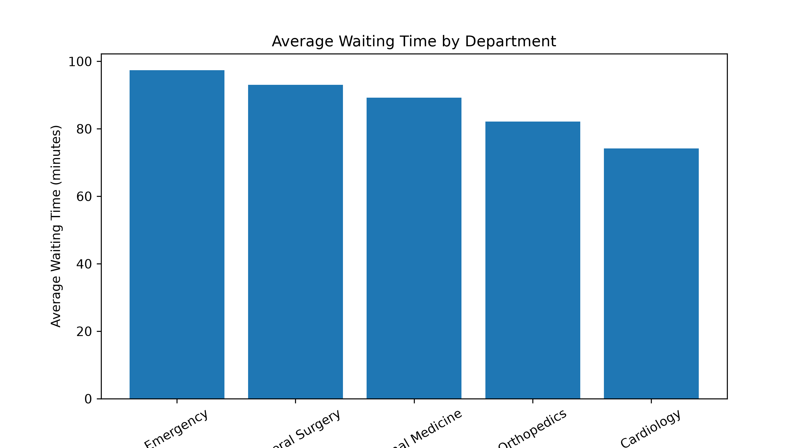
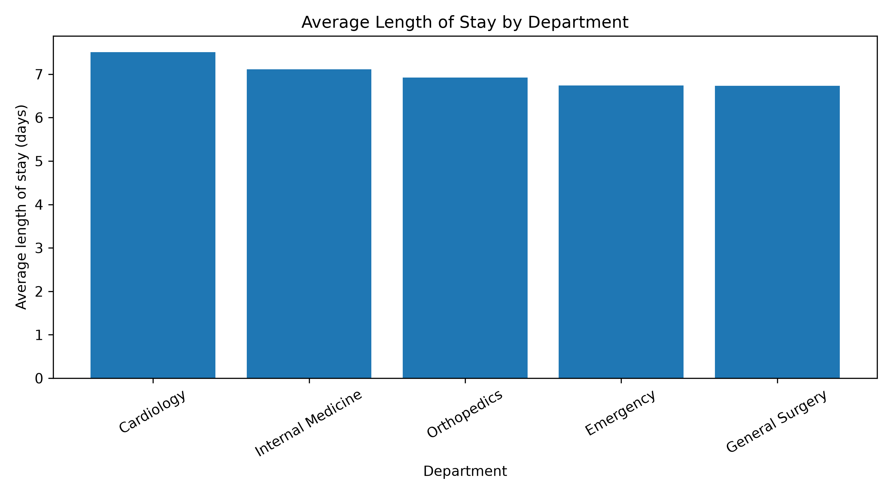

# Hospital Operational Performance Analysis
### Hospital operations data analysis using Python, pandas and Matplotlib
## 1. Project Overview
This project explores hospital operational performance using a synthetic patient dataset.
## 2. Tools & Technologies
- Python
- pandas
- Matplotlib
- Jupyter Notebook
## 3. Data Cleaning
The original dataset contained 162 records.
The cleaning process included:
- Identifying and removing 2 fully duplicated records.
- Identifying missing values.
- Replacing invalid negative waiting times with missing values.
- Converting admission and discharge timestamps to datetime format.
- Calculating patient length of stay.
The cleaned dataset contains 160 records, including records with missing values.
## 4. Key Performance Indicators
| KPI | Result |
|---|---|
| Average Length of Stay | 6.92 days |
| Average Waiting Time | 89.45 minutes |
| Department with Highest Average Waiting Time | Emergency |
| Maximum Departmental Waiting Time Gap | 23.23 minutes |
| Waiting Time Exceeding 120 Minutes | 31.89% (pending verification) |
## 5. Data Visualization
## Average Waiting Time by Department

The Emergency Department had the highest average waiting time, approximately 97.38 minutes, while Cardiology had the lowest, approximately 74.15 minutes.
## Average Length of Stay by Department

Cardiology showed the highest average length of stay, approximately 7.5 days. Differences between departments may reflect variations in patient complexity, clinical pathways, and resource utilization.
## 6. Operational Insights
### Finding 1: Departmental Waiting Time Variation
The difference between the highest and lowest departmental average waiting times was **23.23 minutes**.
### Finding 2: Potential Long-Wait Burden
Approximately **31.89%** of valid waiting-time records exceeded 120 minutes (pending final verification).
### Finding 3: Potential Operational Bottlenecks
The **Emergency Department** had the highest average waiting time (approximately **97.38 minutes**), suggesting a need for further investigation into patient flow and operational capacity.
## 7.Recommendations
Potential next steps include:
1. Analyze patient arrival patterns during peak hours.
2. Investigate staffing levels and resource allocation in the Emergency Department.
3. Examine patient flow and identify possible process bottlenecks.
4. Monitor waiting-time KPIs to evaluate future improvement initiatives.

These recommendations are exploratory and would require additional operational data before implementation.
## 8. Limitations
This project uses synthetic data for educational purposes and does not represent actual hospital performance.

The dataset does not include patient severity, staffing levels, or detailed process timestamps. Therefore, the analysis identifies descriptive patterns rather than causal relationships.
## 9. Project Files
- hospital_data_analysis.ipynb — Python analysis notebook
- cleaned_hospital_data.csv — Cleaned dataset
- synthetic_hospital_data.csv — Original synthetic dataset
- waiting_time_by_department.png — Waiting-time visualization
- length_of_stay_by_department.png — Length-of-stay visualization
## 10. Conclusion
This project demonstrates the application of Python-based data analysis to healthcare operational performance monitoring.

By combining data cleaning, KPI calculation, visualization, and process improvement thinking, the project illustrates how analytical methods can support evidence-informed operational decision-making.
